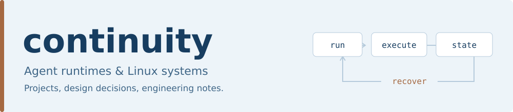
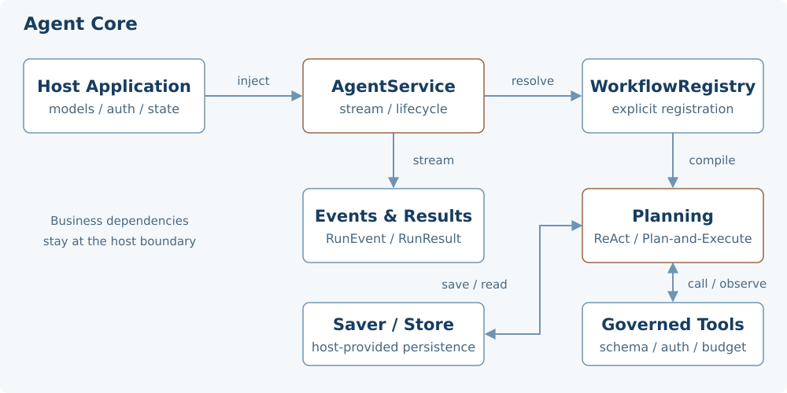
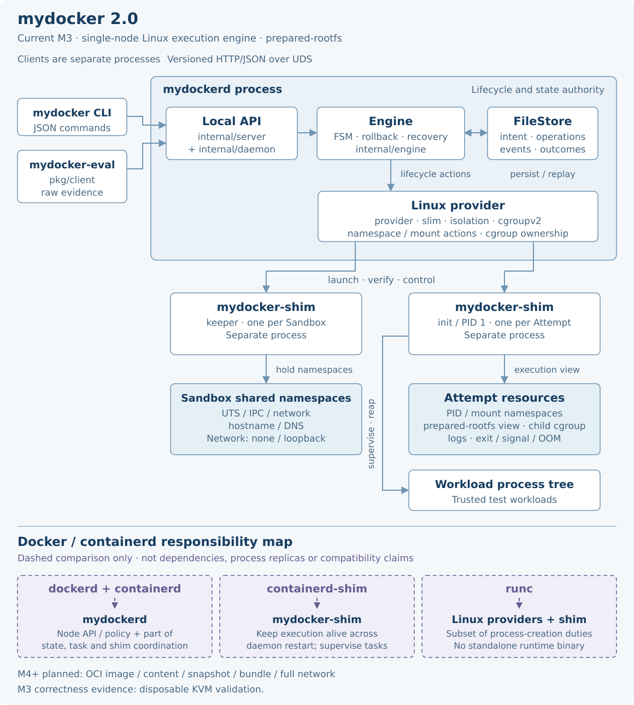

<picture>
  <source media="(prefers-color-scheme: dark)" srcset="assets/banner-dark.svg">
  <source media="(prefers-color-scheme: light)" srcset="assets/banner-light.svg">
  
</picture>

我关注可复用的 Agent 运行内核、Linux 容器执行，以及从界面到服务端的工程交付。
这里整理我的项目、设计取舍和验证记录。

     

[项目](#精选项目) · [架构](#架构一览) · [工程笔记](#工程笔记) · [其他工具与实验](#其他工具与实验)

## 精选项目

<table>
<tr>
<td width="50%" valign="top">
<h3><a href="https://github.com/cont1nu1ty/guofeng-platform">国风平台 · 家风中华行</a></h3>

家风文化业务平台，包含 Uni-app 用户端、Vue 运营后台和 Java 服务端。

关注版本化投稿评审、服务端授权、私有文件、持久数据，以及部署与备份恢复。

<code>Vue / TypeScript</code> <code>Java</code> <code>MySQL / Redis</code>

<a href="https://github.com/cont1nu1ty/guofeng-platform/blob/main/docs/engineering/non-ai-implementation-2026-10-07.md">实现与交付边界</a> · <a href="https://github.com/cont1nu1ty/guofeng-platform/blob/main/docs/verification/non-ai-release-2026-10-08.md">验证记录</a>

</td>
<td width="50%" valign="top">
<h3><a href="https://github.com/cont1nu1ty/mini_gpt_researcher">Mini GPT Researcher</a></h3>

从研究问题到带引用 Markdown 报告的轻量 CLI 原型。

将搜索规划、多后端检索、质量评估、补搜路由、证据精炼和报告校验拆成独立模块，保留可检查的中间结果。

<code>Python</code> <code>LLM</code> <code>Retrieval / Evidence</code>

<a href="https://github.com/cont1nu1ty/mini_gpt_researcher/blob/main/docs/architecture.md">流水线架构</a> · <a href="https://github.com/cont1nu1ty/mini_gpt_researcher/blob/main/docs/development.md">开发与失败边界</a>

</td>
</tr>
<tr>
<td width="50%" valign="top">
<h3><a href="https://github.com/cont1nu1ty/agent_core">Agent Core</a></h3>

从宿主项目抽取的 Python Agent 运行内核，将规划、工具治理、流式事件和恢复机制与业务宿主分离。

基于 LangChain / LangGraph，支持 ReAct 与 Plan-and-Execute；统一管理工具调用预算、超时、取消和执行恢复。

<code>Python</code> <code>LangChain / LangGraph</code> <code>Runtime</code>

<a href="https://github.com/cont1nu1ty/agent_core/blob/main/docs/architecture.md">核心设计</a> · <a href="https://github.com/cont1nu1ty/agent_core/blob/main/examples/offline_react.py">离线示例</a> · <a href="https://github.com/cont1nu1ty/agent_core/blob/main/docs/testing.md">验证入口</a>

</td>
<td width="50%" valign="top">
<h3><a href="https://github.com/cont1nu1ty/mydocker">mydocker 2.0</a></h3>

使用 Go 实现的单节点 Linux 容器执行引擎。

围绕 Sandbox / Attempt 生命周期、cgroup v2、持久状态和 daemon 恢复建立显式契约，记录 M3 范围的一次性 KVM 正确性验收。

<code>Go</code> <code>Linux</code> <code>Namespaces / cgroup v2</code>

<a href="https://github.com/cont1nu1ty/mydocker/blob/main/docs/architecture.md">组件与职责</a> · <a href="https://github.com/cont1nu1ty/mydocker/blob/main/integration/rootful/README.md">M3 验收记录</a>

</td>
</tr>
</table>

## 架构一览

### Agent Core：执行与恢复

宿主注入模型、权限与状态资源，内核负责流程装配、工具治理和流式执行。

<a href="https://github.com/cont1nu1ty/agent_core/blob/main/docs/architecture.md">
<picture>
  <source media="(prefers-color-scheme: dark)" srcset="assets/agent-core-architecture-dark.svg">
  <source media="(prefers-color-scheme: light)" srcset="assets/agent-core-architecture-light.svg">
  
</picture>
</a>

### mydocker：从 API 到 Linux 进程

CLI 和评测工具通过本地 API 访问 `mydockerd`。Engine 编排状态与 Linux provider，keeper 和 init 两种 shim 分别维持 Sandbox 环境与监督每次 Attempt。

<a href="https://github.com/cont1nu1ty/mydocker/blob/main/docs/architecture.md#2-组件模型">
<picture>
  <source media="(prefers-color-scheme: dark)" srcset="assets/mydocker-architecture-dark.svg">
  <source media="(prefers-color-scheme: light)" srcset="assets/mydocker-architecture-light.svg">
  
</picture>
</a>

| Docker / containerd 体系中的职责 | mydocker 当前的设计 |
| --- | --- |
| `dockerd` 的 API 与高层编排 | `mydockerd` 的本地 API、资源与生命周期权威 |
| `containerd` 的任务编排与 shim 管理 | 由同一个 `mydockerd` 进程内的 Engine、FileStore 和 provider 承担相关职责 |
| `containerd-shim` 的执行监督 | `mydocker-shim` 的 keeper / init 两种模式 |
| `runc` 的底层进程创建 | `slim`、`isolation`、`cgroupv2` 与 shim 协作；当前没有独立 runtime 二进制 |

这是职责对照。mydocker 当前 M3 使用 prepared-rootfs；完整镜像导入、content/snapshot、bundle 与网络链路属于 M4+ 设计，详细边界见[组件模型](https://github.com/cont1nu1ty/mydocker/blob/main/docs/architecture.md#2-组件模型)。

国风平台：运营后台界面记录

仓库内内容管理界面记录（2026-09-26）。当前实现及演示数据范围见项目文档。

## 工程笔记

一些关于 Agent 与 Linux 容器运行时的设计思考。

| Agent Core | mydocker |
| --- | --- |
| [运行内核与宿主的职责边界](https://github.com/cont1nu1ty/agent_core/blob/main/docs/notes/host-boundaries.md) | [进程、包与领域对象的职责](https://github.com/cont1nu1ty/mydocker/blob/main/docs/architecture.md) |
| [工具授权、预算与执行治理](https://github.com/cont1nu1ty/agent_core/blob/main/docs/notes/tool-governance.md) | [Sandbox 与 Attempt 生命周期](https://github.com/cont1nu1ty/mydocker/blob/main/docs/features/lifecycle-sandbox.md) |
| [中断后如何恢复执行](https://github.com/cont1nu1ty/agent_core/blob/main/docs/notes/execution-recovery.md) | [Daemon 恢复、事件与本地 API](https://github.com/cont1nu1ty/mydocker/blob/main/docs/features/daemon-recovery-observability-api.md) |
| [离线契约检查与 wheel 验证](https://github.com/cont1nu1ty/agent_core/blob/main/docs/testing.md) | [正确性与性能的证据链](https://github.com/cont1nu1ty/mydocker/blob/main/evaluation/README.md) |

## 其他工具与实验

- [Codex Skills](https://github.com/cont1nu1ty/codex-skills)：个人可复用技能合集；从批判性阅读文章、梳理 Hacker News 分歧开始。
- [ns3_mtd](https://github.com/cont1nu1ty/ns3_mtd/tree/main/src/mtd-benchmark)：基于 ns-3 的移动目标防御仿真与评测模块，连接攻防事件、代理切换和实验数据导出。

## 交流

欢迎通过相关仓库的 Issues 交流设计、复现问题或提出改进建议。
